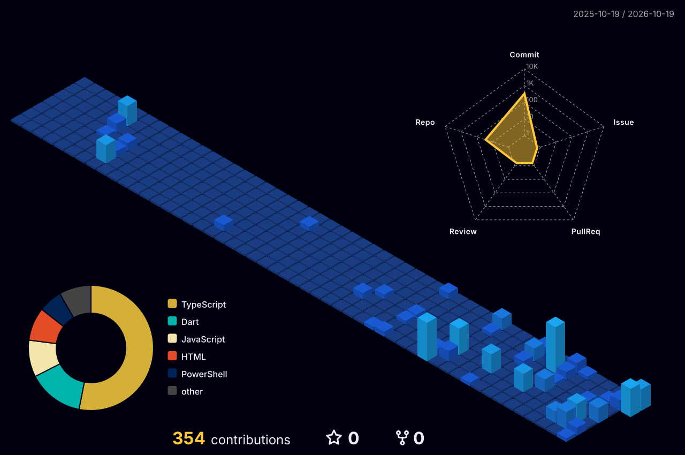

  <h1>Suvesh Kumar</h1>
  
<b>Senior Full Stack &amp; Systems Engineer</b>

  

    
    
    
  

  

    
    
    
    
  

---

### 📊 Contribution Skyline

  

  

---

### 🛠️ My Core Tech

  

    
    
  

  

    
    
  

---

### 📂 My Projects

#### ⚡ [jobscrap](https://github.com/Suvesh108/jobscrap)
> Fast, automated job search tool that collects and cleans listings across LinkedIn, Indeed, Naukri, Glassdoor, and Internshala into one dashboard.
>
> `Python` · `AsyncIO` · `TLS Bypass` · `Data Aggregation` · `REST API`

#### 🌐 [NetPulse](https://github.com/Suvesh108/NetPulse)
> Real-time network speed and latency tester powered by Cloudflare Edge with instant ping and jitter tracking.
>
> `React` · `TypeScript` · `Cloudflare Edge` · `Telemetry` · `TailwindCSS`

#### 📥 [vortex](https://github.com/Suvesh108/vortex)
> High-speed media downloader that downloads parallel chunks and cleanly combines video and audio files.
>
> `TypeScript` · `Node.js` · `Streaming Architecture` · `FFmpeg` · `CLI`

#### 🔗 [BlockVerify](https://github.com/Suvesh108/BlockVerify)
> Product verification app using secure NFC & QR tags to prevent counterfeits and trace product origin.
>
> `JavaScript` · `Blockchain` · `Supply Chain Security` · `NFC / QR` · `Smart Contracts`

---

### 📰 Logs

#### Technical Writing
<!-- BLOG-POST-LIST:START -->
<!-- BLOG-POST-LIST:END -->

#### Recent Activity
<!--START_SECTION:activity-->
1. 🚀 Published release [EDM v0.0.1 — Edge Download Manager](https://github.com/Suvesh108/EDM/releases/tag/v0.0.1) in [Suvesh108/EDM](https://github.com/Suvesh108/EDM)
2. 🚀 Published release [EDM v0.0.1 — Edge Download Manager](https://github.com/Suvesh108/EDM/releases/tag/v0.0.1) in [Suvesh108/EDM](https://github.com/Suvesh108/EDM)
3. 🚀 Published release [Universal Shared v0.2.4](https://github.com/Suvesh108/Universal-Shared/releases/tag/v0.2.4) in [Suvesh108/Universal-Shared](https://github.com/Suvesh108/Universal-Shared)
4. 🚀 Published release [UnitWise v0.0.8 — Dual-Mode Wi-Fi & Bluetooth LE Live Signal Auto-Discovery](https://github.com/Suvesh108/UnitWise/releases/tag/v0.0.8) in [Suvesh108/UnitWise](https://github.com/Suvesh108/UnitWise)
5. 🚀 Published release [UnitWise v0.0.7 — Sense-Grade Vampire Load Disaggregation & Live Dynamic Particle Energy Flow](https://github.com/Suvesh108/UnitWise/releases/tag/v0.0.7) in [Suvesh108/UnitWise](https://github.com/Suvesh108/UnitWise)
6. 🚀 Published release [UnitWise v0.0.6 — Real IoT Discovery & Fluid Motion](https://github.com/Suvesh108/UnitWise/releases/tag/v0.0.6) in [Suvesh108/UnitWise](https://github.com/Suvesh108/UnitWise)
7. 🚀 Published release [UnitWise v0.0.5 — Multi-Property Management & Dynamic Live OTA](https://github.com/Suvesh108/UnitWise/releases/tag/v0.0.5) in [Suvesh108/UnitWise](https://github.com/Suvesh108/UnitWise)
8. 🚀 Published release [UnitWise v0.0.4 — Minimalist UI/UX Overhaul & Interactive Donut Graph](https://github.com/Suvesh108/UnitWise/releases/tag/v0.0.4) in [Suvesh108/UnitWise](https://github.com/Suvesh108/UnitWise)
9. 🚀 Published release [UnitWise v0.0.3 — Dual-Mode Auto-Discovery Scanner & Synchronized OTA](https://github.com/Suvesh108/UnitWise/releases/tag/v0.0.3) in [Suvesh108/UnitWise](https://github.com/Suvesh108/UnitWise)
10. 🚀 Published release [v0.0.1 - UnitWise Prototype Release](https://github.com/Suvesh108/UnitWise/releases/tag/v0.0.1) in [Suvesh108/UnitWise](https://github.com/Suvesh108/UnitWise)
<!--END_SECTION:activity-->

---

  
    
  
  

