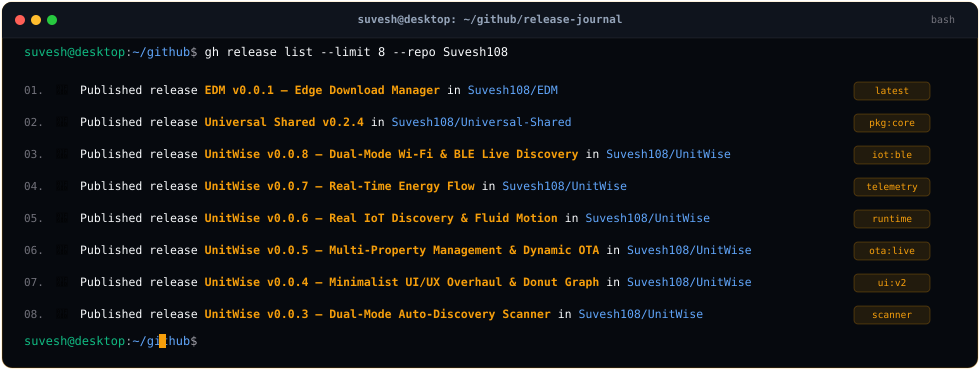

# Suvesh Kumar

### `Senior Full Stack & Systems Engineer`

  <em>Distributed Systems &nbsp;·&nbsp; Edge Infrastructure &nbsp;·&nbsp; Async Pipelines &nbsp;·&nbsp; High Concurrency</em>

  
  &nbsp;
  
  &nbsp;
  
  &nbsp;
  

  
  &nbsp;
  
  &nbsp;
  
  &nbsp;
  

---

### ⚡ About

Building resilient, high-performance software at the intersection of distributed infrastructure and modern full-stack systems. Shipping production-grade code across **29+ public repositories** — from low-latency edge telemetry platforms to high-throughput data pipelines and blockchain provenance tools.

- 🔭 **Currently Building:** [UnitWise](https://github.com/Suvesh108/UnitWise) — Sense-grade IoT multi-property telemetry platform with live Wi-Fi & Bluetooth LE signal analysis
- 🛠️ **Core Focus:** Distributed edge nodes, lock-free concurrency, asynchronous pipelines, low-latency streaming
- 🔒 **Engineering Invariants:** 100% schema validation, zero-trust perimeter, parameterized queries, deterministic builds

---

### 🏔️ Contribution Skyline

  

 

  

---

### 🛠️ Core Tech Arsenal

<table width="100%">
  <tr>
    <td width="50%" valign="top">
      <h4>&nbsp;Languages</h4>
      

        
        
        
        
        
        
        
      

    </td>
    <td width="50%" valign="top">
      <h4>&nbsp;Frontend & APIs</h4>
      

        
        
        
        
        
      

    </td>
  </tr>
  <tr>
    <td width="50%" valign="top">
      <h4>&nbsp;Storage & Messaging</h4>
      

        
        
        
        
      

    </td>
    <td width="50%" valign="top">
      <h4>&nbsp;Cloud & Infrastructure</h4>
      

        
        
        
        
        
      

    </td>
  </tr>
</table>

---

### 🚀 Featured Systems

<table width="100%">
  <tr>
    <td width="50%" valign="top">
      <h4><a href="https://github.com/Suvesh108/jobscrap">jobscrap</a> </h4>
      
High-throughput automated job search engine that aggregates and normalizes listings across LinkedIn, Indeed, Naukri, Glassdoor, and Internshala into a unified dashboard.

      

        
        
        
        
      

    </td>
    <td width="50%" valign="top">
      <h4><a href="https://github.com/Suvesh108/NetPulse">NetPulse</a> </h4>
      
Real-time network speed and latency diagnostic platform powered by globally distributed Cloudflare Edge Workers with sub-5ms ping and jitter tracking.

      

        
        
        
        
      

    </td>
  </tr>
  <tr>
    <td width="50%" valign="top">
      <h4><a href="https://github.com/Suvesh108/UnitWise">UnitWise</a> </h4>
      
Sense-grade multi-property IoT platform with dual-mode Wi-Fi & Bluetooth LE auto-discovery, vampire load disaggregation, and synchronized OTA firmware delivery.

      

        
        
        
        
      

    </td>
    <td width="50%" valign="top">
      <h4><a href="https://github.com/Suvesh108/vortex">vortex</a> </h4>
      
High-throughput CLI media streaming downloader built with parallel chunk retrieval, backpressure stream pipes, and seamless audio/video multiplexing.

      

        
        
        
        
      

    </td>
  </tr>
  <tr>
    <td width="50%" valign="top">
      <h4><a href="https://github.com/Suvesh108/BlockVerify">BlockVerify</a> </h4>
      
Cryptographic anti-counterfeit product verification using secure physical NFC/QR tags backed by on-chain smart contracts and cryptographic Merkle proofs.

      

        
        
        
        
      

    </td>
    <td width="50%" valign="top">
      <h4><a href="https://github.com/Suvesh108/EDM">EDM</a> </h4>
      
Low-latency Edge Download Manager written in Rust featuring resumable parallel multipart byte range downloads with zero external runtime dependencies.

      

        
        
        
        
      

    </td>
  </tr>
</table>

---

### 🛡️ Engineering Invariants

<table width="100%">
  <tr>
    <td width="25%" align="left">
      <b>🔒 Zero Trust & Defense</b>
       
      Strict schema validation (Zod/Pydantic) on 100% of external boundaries & parameterized storage.
    </td>
    <td width="25%" align="left">
      <b>⚡ Sub-5ms Edge Latency</b>
       
      Distributed Cloudflare Workers, edge compute caching, and minimized protocol round-trips.
    </td>
    <td width="25%" align="left">
      <b>🔄 High Concurrency</b>
       
      Lock-free patterns, non-blocking asynchronous event loops, and parallel backpressured streams.
    </td>
    <td width="25%" align="left">
      <b>📦 Deterministic Releases</b>
       
      Containerized multi-stage builds, rigorous unit/integration suites, and zero-downtime releases.
    </td>
  </tr>
</table>

---

### 📋 Release Journal

  

---

  
  &nbsp;·&nbsp;
  <a href="https://suvesh.io"><b>suvesh.io</b></a>
  &nbsp;·&nbsp;
  <a href="https://github.com/Suvesh108?tab=repositories"><b>29 Public Repositories</b></a>

Crafted with engineering discipline & precision · Suvesh Kumar

