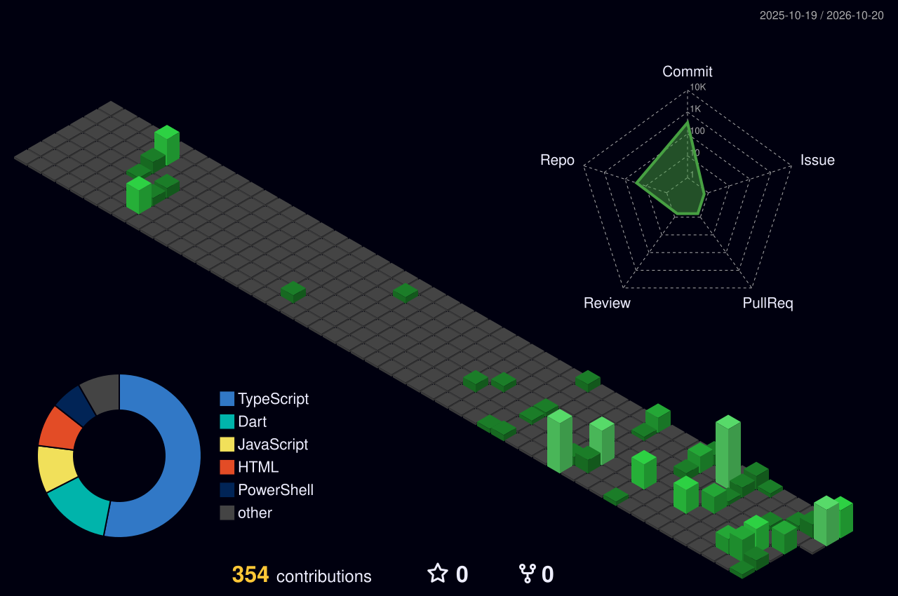

<div align="center">

# Suvesh Kumar

### `Full Stack Developer & Systems Builder`

<p align="center">
  <em>Fast Web Apps &nbsp;·&nbsp; Cloud Services &nbsp;·&nbsp; Backend APIs &nbsp;·&nbsp; Clean Code</em>
</p>

<p align="center">
  <a href="https://suvesh.io"></a>
  &nbsp;
  <a href="https://linkedin.com/in/suvesh108"></a>
  &nbsp;
  <a href="mailto:suvesh108@email.com"></a>
  &nbsp;
  <a href="https://x.com/suvesh108"></a>
</p>

<p align="center">
  
  &nbsp;
  
  &nbsp;
  
  &nbsp;
  
</p>

</div>

---

### ⚡ About Me

I build fast web apps, cloud services, and developer tools. I love creating smooth user interfaces, reliable backend APIs, and lightweight programs that get the job done. I have **29+ open source projects** on GitHub — from smart home dashboards to web scrapers and download managers.

- 🔭 **Current Project:** [UnitWise](https://github.com/Suvesh108/UnitWise) — A smart home dashboard to find and manage connected devices via Wi-Fi and Bluetooth
- 🛠️ **Favorite Stack:** Go, Rust, TypeScript, Python, React, and Docker
- 💬 **Ask Me About:** Web development, fast APIs, cloud servers, and clean code

---

### 🏔️ Contribution Skyline

<div align="center">
  
</div>

<br/>

<div align="center">
  
</div>

---

### 🛠️ Tech & Tools

<table width="100%">
  <tr>
    <td width="50%" valign="top">
      <h4>&nbsp;Languages</h4>
      <p>
        
        
        
        
        
        
        
      </p>
    </td>
    <td width="50%" valign="top">
      <h4>&nbsp;Frontend & APIs</h4>
      <p>
        
        
        
        
        
      </p>
    </td>
  </tr>
  <tr>
    <td width="50%" valign="top">
      <h4>&nbsp;Databases & Storage</h4>
      <p>
        
        
        
        
      </p>
    </td>
    <td width="50%" valign="top">
      <h4>&nbsp;Cloud & Tools</h4>
      <p>
        
        
        
        
        
      </p>
    </td>
  </tr>
</table>

---

### 🚀 Projects

<table width="100%">
  <tr>
    <td width="50%" valign="top">
      <h4><a href="https://github.com/Suvesh108/jobscrap">jobscrap</a> </h4>
      <p>A fast job finder that collects and organizes job posts from LinkedIn, Indeed, Naukri, Glassdoor, and Internshala into one clean dashboard.</p>
      <p>
        
        
        
      </p>
    </td>
    <td width="50%" valign="top">
      <h4><a href="https://github.com/Suvesh108/NetPulse">NetPulse</a> </h4>
      <p>A live internet speed and ping checker that tests your network latency in real time using Cloudflare edge servers.</p>
      <p>
        
        
        
        
      </p>
    </td>
  </tr>
  <tr>
    <td width="50%" valign="top">
      <h4><a href="https://github.com/Suvesh108/UnitWise">UnitWise</a> </h4>
      <p>A smart home dashboard that automatically finds nearby Wi-Fi and Bluetooth devices, tracks power usage, and sends wireless updates.</p>
      <p>
        
        
        
        
      </p>
    </td>
    <td width="50%" valign="top">
      <h4><a href="https://github.com/Suvesh108/vortex">vortex</a> </h4>
      <p>A fast command-line tool that downloads videos in parallel pieces and smoothly joins video and audio files together.</p>
      <p>
        
        
        
        
      </p>
    </td>
  </tr>
  <tr>
    <td width="50%" valign="top">
      <h4><a href="https://github.com/Suvesh108/BlockVerify">BlockVerify</a> </h4>
      <p>An anti-fake product checker that uses NFC and QR tags with smart contracts so buyers can verify real items in seconds.</p>
      <p>
        
        
        
        
      </p>
    </td>
    <td width="50%" valign="top">
      <h4><a href="https://github.com/Suvesh108/EDM">EDM</a> </h4>
      <p>A lightweight download tool built in Rust that can pause, resume, and split downloads into pieces for maximum speed.</p>
      <p>
        
        
        
        
      </p>
    </td>
  </tr>
</table>

---

### 💡 How I Build

<table width="100%">
  <tr>
    <td width="25%" align="left">
      <b>🔒 Safe & Secure</b>
      <br/>
      <sub>Always validate data and sanitize inputs so user information stays secure.</sub>
    </td>
    <td width="25%" align="left">
      <b>⚡ Fast & Light</b>
      <br/>
      <sub>Optimize server responses and avoid heavy packages so apps load fast.</sub>
    </td>
    <td width="25%" align="left">
      <b>🔄 Smooth Multitasking</b>
      <br/>
      <sub>Use non-blocking async code so apps never freeze under heavy traffic.</sub>
    </td>
    <td width="25%" align="left">
      <b>📦 Easy to Ship</b>
      <br/>
      <sub>Use Docker and automated tests so new updates release smoothly with zero downtime.</sub>
    </td>
  </tr>
</table>

---

### 📋 Recent Releases

```console
suvesh@desktop:~/github$ gh release list --limit 8 --repo Suvesh108

01. 🚀  EDM v0.0.1           Edge Download Manager                  [latest]
02. 🚀  Universal-Shared     Core Shared Library v0.2.4             [pkg:core]
03. 🚀  UnitWise v0.0.8      Wi-Fi & Bluetooth Device Discovery     [iot:ble]
04. 🚀  UnitWise v0.0.7      Live Energy Tracking & Power Flow      [telemetry]
05. 🚀  UnitWise v0.0.6      Smooth IoT Discovery & Motion          [runtime]
06. 🚀  UnitWise v0.0.5      Multi-Home Setup & Wireless Updates    [ota:live]
07. 🚀  UnitWise v0.0.4      Clean New Design & Power Chart         [ui:v2]
08. 🚀  UnitWise v0.0.3      Auto-Scanner & Device Sync             [scanner]
```

---

<div align="center">

<p>
  
  &nbsp;·&nbsp;
  <a href="https://suvesh.io"><b>suvesh.io</b></a>
  &nbsp;·&nbsp;
  <a href="https://github.com/Suvesh108?tab=repositories"><b>29 Public Repositories</b></a>
</p>

<sub>Built by Suvesh Kumar</sub>

</div>
