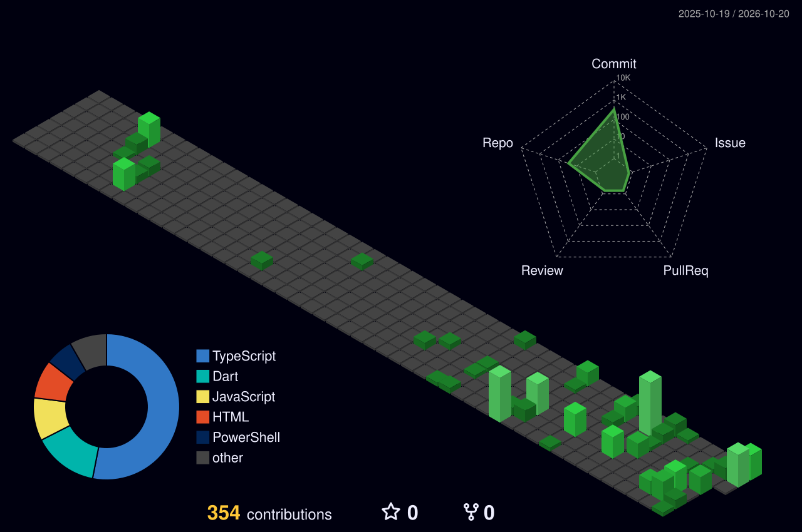

<div align="center">


### Senior Full Stack & Systems Engineer

*Edge Infrastructure · Go · Rust · TypeScript · Python*

<br/>

[](https://suvesh.io)
[](https://linkedin.com/in/suvesh108)
[](mailto:suvesh108@email.com)
[](https://x.com/suvesh108)

<br/>


&nbsp;

&nbsp;

&nbsp;


</div>

<br/>

---

## About

Building resilient, high-performance software at the intersection of distributed infrastructure and modern full-stack development. I ship clean, production-grade code across **29+ public repositories** — from IoT telemetry platforms to blockchain provenance systems.

- 🔭 **Currently:** [UnitWise](https://github.com/Suvesh108/UnitWise) — IoT multi-property management with Wi-Fi & BLE live signal analysis
- ⚡ **Expertise:** Edge infrastructure, async/concurrent pipelines, multi-threaded systems
- 🔐 **Standards:** Tested, secure, zero-compromise code quality

---

## Stats

<div align="center">


&nbsp;&nbsp;


</div>

<div align="center">


</div>

---

## Activity

<div align="center">


</div>

---

## Contribution Skyline

<div align="center">



</div>

<div align="center">


</div>

---

## Tech Stack

<div align="center">

**Languages**


**Frontend & APIs**


**Storage & Infrastructure**


**Cloud & Edge**


</div>

---

## Projects

<table>
<tr>
<td width="50%" valign="top">

**[jobscrap](https://github.com/Suvesh108/jobscrap)**&ensp;`Python · AsyncIO`

Fast, automated multi-source job aggregator. Scrapes LinkedIn, Indeed, Naukri, Glassdoor & Internshala into one unified dashboard with TLS camouflage.


</td>
<td width="50%" valign="top">

**[NetPulse](https://github.com/Suvesh108/NetPulse)**&ensp;`TypeScript · Edge`

Real-time network speed and latency tester powered by Cloudflare Edge workers with sub-5ms ping and jitter tracking.


</td>
</tr>
<tr>
<td width="50%" valign="top">

**[UnitWise](https://github.com/Suvesh108/UnitWise)**&ensp;`Go · IoT`

Sense-grade IoT platform for multi-property management with Wi-Fi & BLE auto-discovery, vampire load disaggregation, and live OTA updates.


</td>
<td width="50%" valign="top">

**[vortex](https://github.com/Suvesh108/vortex)**&ensp;`Node.js · CLI`

High-speed media downloader with parallel chunk fetching, stream pipes, and FFmpeg muxing — built for throughput at scale.


</td>
</tr>
<tr>
<td width="50%" valign="top">

**[BlockVerify](https://github.com/Suvesh108/BlockVerify)**&ensp;`Solidity · NFC`

Blockchain provenance system using NFC & QR tags with on-chain Merkle proofs to prevent counterfeits and trace product origin.


</td>
<td width="50%" valign="top">

**[EDM](https://github.com/Suvesh108/EDM)**&ensp;`Rust · CLI`

Low-latency Edge Download Manager with resumable parallel chunk fetching, minimal CLI interface, and zero-dependency Rust core.


</td>
</tr>
</table>

---

## Recent Releases

```
  suvesh@desktop:~/github$ gh release list --limit 10 --repo Suvesh108
  ────────────────────────────────────────────────────────────────────
  [SYSTEM] 10 release artifacts synchronized

  01  🚀  EDM v0.0.1 — Edge Download Manager                   [latest]
  02  🚀  EDM v0.0.1 — Edge Download Manager                   [tag:v0.0.1]
  03  🚀  Universal-Shared v0.2.4                              [pkg:core]
  04  🚀  UnitWise v0.0.8 — Dual-Mode Wi-Fi & BLE Discovery    [iot:ble]
  05  🚀  UnitWise v0.0.7 — Vampire Load Disaggregation        [telemetry]
  06  🚀  UnitWise v0.0.6 — Real IoT Discovery & Fluid Motion  [runtime]
  07  🚀  UnitWise v0.0.5 — Multi-Property & Live OTA          [ota:live]
  08  🚀  UnitWise v0.0.4 — Minimalist UI/UX Overhaul          [ui:v2]
  09  🚀  UnitWise v0.0.3 — Dual-Mode Auto-Discovery Scanner   [scanner]
  10  🚀  UnitWise v0.0.1 — Prototype Release                  [initial]

  suvesh@desktop:~/github$ █
```

---

<div align="center">


*Suvesh Kumar · Senior Distributed Systems & Full Stack Architect*

</div>
